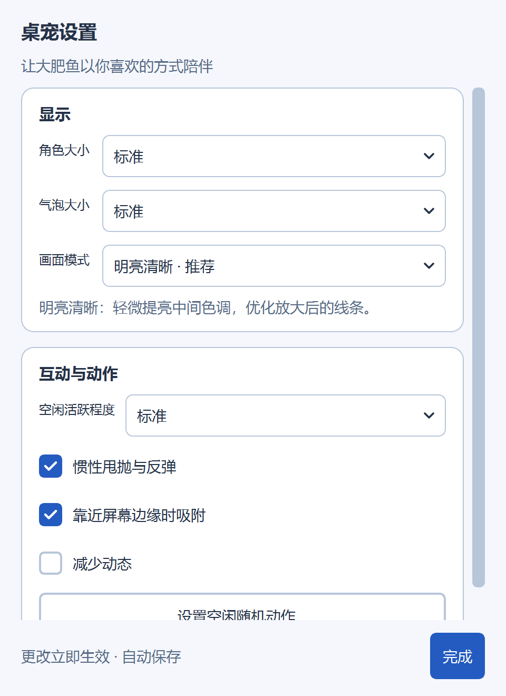
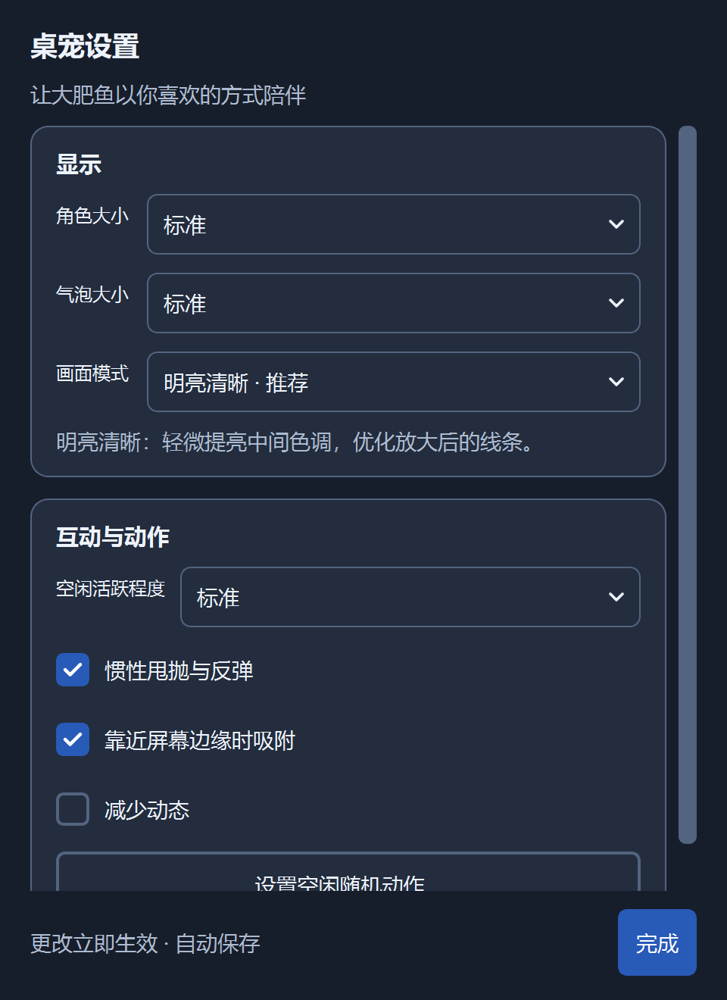

# Codex 大肥鱼 🐋

住在桌面上的陪伴桌宠。使用 Codex 工作时，它会跟随本地任务切换动作；不使用 Codex 时，也可以摸摸头、拖着走、看它吃饭和跳舞。

[下载 Windows 便携版](https://github.com/Synchronized2/dafeiyu/releases/latest) · [更新记录](CHANGELOG.md) · [素材授权](ASSET_LICENSE.md)


## 下载与运行

支持 **Windows 10/11 x64**。在 [Releases](https://github.com/Synchronized2/dafeiyu/releases/latest) 下载 **`Codex-Dafeiyu-v1.0.0-Windows-x64.zip`**，完整解压，双击 **`Codex大肥鱼.cmd`**。

- 内置 Python、Qt 和全部动画，不需要安装 Python、Node.js 或填写 API Key。
- 放在本地可写目录中运行，保留 `.windows-runtime`、`assets` 等完整目录结构。
- 纯陪伴模式：双击 **`独立陪伴.cmd`**；也可以右键切换“跟随 Codex 任务”。
- 重启：右键 → **重启**，自动保存位置与设置，保留当前跟随/独立陪伴模式。
- 退出：右键 → **本次关闭**。重复启动不会额外打开同一目录下的桌宠。
- GitHub 自动生成的 `Source code (zip/tar.gz)` 不含运行库和完整动画，普通用户请选择上述便携包。

同一 Release 提供 `SHA256SUMS.txt`，可检查下载完整性：

```powershell
Get-FileHash .\Codex-Dafeiyu-v1.0.0-Windows-x64.zip -Algorithm SHA256
```

## 功能

- **任务陪伴**：思考、工作、等待确认、完成和异常等状态；多主聊天显示任务列表，同一聊天的多份记录会合并，后台辅助代理默认不单独计数。
- **95 个动作、16 类**：右键搜索、分类、直接播放一次或循环播放；可勾选允许空闲时随机出现的动作。
- **鼠标互动**：摸头、戳身体、碰尾巴、拖动、惯性甩抛与反弹、拖拽方向倾斜、四边扒边、悬停时钟与关心话、空闲自动溜达、召回主屏幕右下角。
- **显示与设置**：角色与气泡大小、活跃程度、减少动态；浅色/深色主题下清楚的勾选与选中状态，更改立即生效并自动保存。
- **每显示器 DPI 感知**：Windows PerMonitorV2，Qt 逻辑坐标与分数缩放；跨屏拖动时更新显示器、绘制缓存和运动边界，适配缩放变化及显示器移除。
- **三种画面模式**：“明亮清晰”“自然清晰”“原始画面”。基础动画重新从原视频提取为无损 WebP，适配高 DPI；切换动作只绘制当前帧，避免姿势叠加重影。

原始视频为 **640×360**。增强改善中间色调、线条和二次压缩损失，不会凭空增加原生分辨率。“吃 Token”等动画只作陪伴，不影响真实模型额度。

<p>
  
  
</p>

## Codex 如何连接

默认读取本地 `%USERPROFILE%\.codex\sessions` 下的 JSONL 任务记录；设置 `CODEX_HOME` 时读取该目录的 `sessions` 子目录。Codex 尚未启动时保持陪伴，有新任务记录后自动跟随。

指定记录目录或单个聊天：

```bat
start-codex-pet.cmd --codex-home "D:\my-codex-home"
start-codex-pet.cmd --thread 聊天ID
```

Codex 在 WSL 内运行时，指定对应发行版的目录，发行版需已启动：

```bat
start-codex-pet.cmd --codex-home "\\wsl.localhost\Ubuntu\home\用户名\.codex"
```

桌宠仅观察本地记录，不修改 Codex 设置、不提交提示词、不调用模型 API；退出桌宠不会停止 Codex 任务。这是独立的社区项目，**不是 OpenAI 官方插件**。

限制：云端任务没有本地记录时无法跟随；等待确认取决于日志中可识别的事件，不能捕获所有权限弹窗；默认跟随最近的本机任务，不代表前台聊天。不显示隐藏推理或虚构的完成百分比，长时间无新事件会提示等待记录更新。Codex 日志格式变化后可能需要适配。

## 设置与排查

右键 → **桌宠设置**。“甩抛响应重力”默认开启；关闭后只保留惯性移动和碰壁反弹，逐渐减速后停在当前位置。两种模式都会在甩抛时显示“被吓一跳”，停稳后恢复原动作。动作库中的勾选只控制空闲随机动作，不会立即播放；“减少动态”会停用随机动作和甩抛。

互动设置中可单独关闭“扒边”“悬停提示”和“自动溜达”。按住拖动时人物随方向倾斜，慢放到屏幕四边会只露出头，左右旋转 90°、顶部向下探头、底部向上探头；快速甩出仍然反弹。扒边后可拖出来，或右键 → **出来玩**。

贴边以人物可见轮廓计算，透明画布和状态气泡不会挡住人物靠边。执行任务时也可手动扒边；需要输入、报错和完成提示会恢复完整人物。状态气泡默认缩小约 20%，可在设置中继续选择大小。

人物原生窗口只包住当前动作的可见轮廓；气泡使用独立的鼠标穿透窗口，宽度跟随人物大小，在屏幕内自动放到人物上方或下方。

设置中的角色与气泡大小均支持滑块实时调整，显示百分比并自动保存；原有大小预设保留。角色可调 40%–180%，气泡可调 60%–160%。

“扒边大小”可独立调节 50%–200%，保留小／标准／大预设；扒边时拖动滑块会立即调整脑袋大小并保持贴边，不改变完整人物的大小。

鼠标在人物实际可见像素上停留约半秒时显示日期、实时时钟和关心话（气泡设为隐藏时不显示）；经过透明边距不触发。自动溜达在空闲时短距离移动，悬停、拖拽、甩抛、扒边、打开面板、播放手动动作和有任务时暂停。“减少动态”也会停用溜达与拖拽倾斜。

交互参考与来源许可见 [交互适配说明](docs/interaction-reference.md)。

配置和日志保存在启动目录 `.local/`，不提交到 GitHub：

- `layout.json`：位置、显示与动作偏好。
- `helper.log`：原生窗口诊断。
- `companion.log`：启动及任务观察器诊断。

双击无反应时，确认已完整解压、运行目录可写，再检查日志。终端诊断可运行 `start-codex-pet.cmd --headless --duration 5`。更新前关闭旧桌宠，需要保留偏好可备份并恢复 `.local/layout.json`。

## 从源码运行

需要 **64 位 Python 3.10–3.14**。Git 仓库保留源码、素材清单和许可证，完整动画帧与 Windows 运行库通过 Release 提供。

```powershell
git clone https://github.com/Synchronized2/dafeiyu.git
cd dafeiyu
python scripts/fetch-assets.py
.\setup-windows.cmd
.\Codex大肥鱼.cmd
```

下载脚本读取 `release-assets.json`，下载固定版本素材包并核对 SHA-256，仅提取安全的 `assets/pet/` 文件。也可手动下载 `Dafeiyu-v1.0.0-assets.zip` 并在仓库根目录解压。安装/下载时需联网，动画播放在本地完成。

Linux 可使用同一份 Python 源码和素材，安装 Qt 系统依赖后运行：

```bash
python3 -m venv .venv
. .venv/bin/activate
python -m pip install -r requirements.txt
python scripts/fetch-assets.py
python codex_companion.py
# 纯陪伴
python codex_companion.py --standalone
```

v1.0.0 提供并验证的是 **Windows x64 便携包**，未发布 Linux/macOS 二进制包。Wayland 会优先尝试 XWayland，窗口行为受桌面环境影响。

## 开发与验证

```powershell
.\.venv-windows\Scripts\python.exe -m unittest discover -s codex_tests -v
```

先下载素材；图形测试需要可用桌面。测试覆盖任务识别/去重、过期事件、失败退出、透明通道、画面模式、设置保存和高 DPI 动作切换。

v1.0.0 已在 Windows / 200% DPI 下通过 21 项回归测试，检查浅色/深色界面和原生启动/退出。发行包排除用户配置、日志、聊天记录和缓存，包含 `BUNDLE.json` 文件校验清单。构建方法见 [发布说明](docs/RELEASING.md)。

## 来源与授权

感谢以下项目与作者：

- [QCYTSN/dsh-dafeiyu](https://github.com/QCYTSN/dsh-dafeiyu)：桌宠上游，基于 0.1.19 适配，保留原 MIT 版权声明。
- [PC2005-cloud/dsh-pet](https://github.com/PC2005-cloud/dsh-pet)：原角色与基础动画，固定来源及摘要见素材清单。
- [luweiyabo/dsh-whale-pet](https://github.com/luweiyabo/dsh-whale-pet)：社区扩展动作，提交与独立媒体条款见 `assets/community-notices/`。
- Chromium 光标、Python、PySide6/Qt、Pillow 的许可证随相关文件保留。

**代码采用 MIT；完整发行包为混合授权。89 组社区扩展动画受独立的开源、非商业使用条款约束，不能将整个素材包视为 MIT 商用素材。** 详见 [ASSET_LICENSE.md](ASSET_LICENSE.md) 和 [第三方素材声明](assets/community-notices/THIRD_PARTY_ASSETS.md)。

本项目与 OpenAI、DeepSeek 及上游作者无官方隶属关系。反馈请使用 [Issues](https://github.com/Synchronized2/dafeiyu/issues)，上传截图和日志前请移除个人路径及任务内容。
