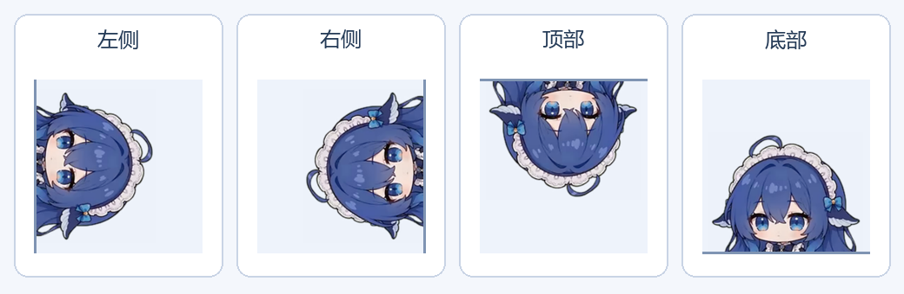
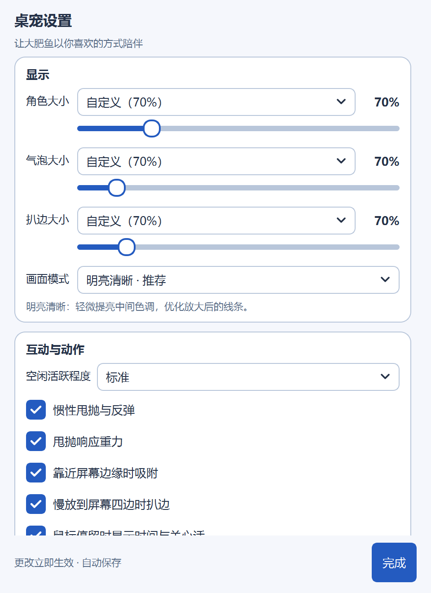

# Codex 大肥鱼 🐋

住在桌面上的陪伴桌宠。使用 Codex 工作时，它会跟随本地任务切换动作；不使用 Codex 时，也可以摸摸头、拖着走、看它吃饭和跳舞。

[下载已发布的 Windows 便携版](https://github.com/Synchronized2/dafeiyu/releases/latest) · [运行最新源码](#从源码运行) · [更新记录](CHANGELOG.md) · [素材授权](ASSET_LICENSE.md)

> **版本说明**：本文介绍当前 `main` 分支。已发布的便携包仍为 **v1.0.0**，不包含后续新增的四边扒边、大小滑块、悬停时钟、自动溜达等功能。体验这些功能请运行最新源码；仅下载 v1.0.0 ZIP 不会获得后续更新。


## 当前功能

- **任务陪伴**：跟随本地 Codex 的思考、工作、等待确认、完成和异常状态；支持多主聊天任务列表、重复记录合并，后台辅助代理默认不单独计数。
- **95 个动作、16 类**：右键搜索和分类，播放一次或循环播放；可勾选允许空闲时随机出现的动作。
- **拖拽与甩抛**：拖动时随方向倾斜，甩出后惯性移动、碰壁反弹；运动期间播放“被吓一跳”，停稳后继续原动作及手动循环进度。
- **可选重力**：默认开启，甩出后会落下；关闭后保留惯性、四边反弹与阻尼，可以停在空中。
- **四边扒边**：慢放到左右、顶部或底部，只露出脑袋；支持独立调节大小、拖出恢复及重启恢复。
- **悬停与溜达**：鼠标停在人物可见像素上约半秒，显示日期、实时时钟和关心话；空闲时短距离溜达，用户操作与任务优先。
- **三个大小滑块**：角色、气泡、扒边大小分别调节，保留预设，实时预览、百分比显示、自动保存。
- **紧凑透明窗口**：按当前动作的可见轮廓裁切窗口，去掉大片透明留白；气泡独立显示且鼠标可穿透，不参与人物贴边和碰撞。
- **显示适配**：三种画面模式、Windows PerMonitorV2、分数缩放及显示器变化处理；更改设置立即生效。
- **右键重启**：保存位置与设置，重建桌宠窗口和任务观察器，保留当前跟随／独立陪伴模式。

原始视频为 **640×360**。“明亮清晰”“自然清晰”改善中间色调、线条和二次压缩损失，不会凭空增加原生分辨率；“原始画面”保留原像素。动作切换仅绘制当前帧，避免姿势叠加重影。“吃 Token”等动画只作陪伴，不影响真实模型额度。

## 四边扒边与鼠标互动

拖动到边缘后，**稍停再松手**即可扒边；快速甩出仍会反弹。屏幕角落选择距离最近的一边。

- **左右**：脑袋旋转 90°，从侧边探出。
- **顶部**：倒挂向下探头。
- **底部**：直立向上探头，贴在任务栏上方的桌面可用边缘。
- **恢复**：直接拖出来，或右键 → **出来玩**。



执行任务时也可以手动扒边；需要输入、报错和完成提示会恢复完整人物。位置、扒边方向和大小自动保存。

悬停只识别人物实际可见像素，经过透明边距不触发。气泡设为隐藏时，悬停也不会强制显示。自动溜达在悬停、拖拽、甩抛、扒边、打开面板、播放手动动作或有任务时暂停。“减少动态”会停用溜达、拖拽倾斜、随机动作与甩抛。

## 大小与设置

右键 → **桌宠设置 → 显示**，拖动滑块立即预览并自动保存：

- **角色大小：40%–180%**，保留迷你／小／标准／大预设。
- **气泡大小：60%–160%**，保留小／标准／大预设。
- **扒边大小：50%–200%**，保留小／标准／大预设；在角色大小基础上单独调整露出的脑袋，保持贴边，不改变完整人物大小。

自定义大小统一显示为 **“自定义（70%）”**，重新打开设置仍保留百分比；配置文件内部使用 `0.7` 等比例值。气泡宽度还会随人物大小调整，在屏幕内自动放到人物上方或下方。

<p>
  
</p>

互动设置可单独开关惯性、重力、边缘吸附、四边扒边、悬停提示和自动溜达。动作库中的勾选只控制空闲随机动作，不会立即播放。右键 → **回到右下角**可召回主屏幕；右键 → **重启**可重新加载程序；**本次关闭**退出桌宠。

## 下载已发布的便携版

**Windows 10/11 x64**：在 [Releases](https://github.com/Synchronized2/dafeiyu/releases/latest) 下载 **`Codex-Dafeiyu-v1.0.0-Windows-x64.zip`**，完整解压后双击 **`Codex大肥鱼.cmd`**。这个旧版本的功能范围见 [v1.0.0 发布说明](https://github.com/Synchronized2/dafeiyu/releases/tag/v1.0.0)，本文上述新增功能请使用最新源码。

- 内置 Python、Qt 和全部动画，不需要安装 Python、Node.js 或填写 API Key。
- 放在本地可写目录，保留 `.windows-runtime`、`assets` 等完整目录结构。
- 纯陪伴模式：双击 **`独立陪伴.cmd`**；也可右键切换“跟随 Codex 任务”。
- 重复启动不会额外打开同一目录下的桌宠。
- GitHub 自动生成的 `Source code (zip/tar.gz)` 不含运行库和完整动画，不能当作便携包直接双击运行。

同一 Release 提供 `SHA256SUMS.txt`，可检查下载完整性：

```powershell
Get-FileHash .\Codex-Dafeiyu-v1.0.0-Windows-x64.zip -Algorithm SHA256
```

## 从源码运行

需要 **64 位 Python 3.10–3.14**。Git 仓库保留源码、素材清单和许可证，完整动画帧通过固定版本素材包提供。最新源码可以复用 v1.0.0 素材包，无需复制旧版程序文件。

### Windows

```powershell
git clone https://github.com/Synchronized2/dafeiyu.git
cd dafeiyu
python scripts/fetch-assets.py
.\setup-windows.cmd
.\Codex大肥鱼.cmd
```

已有源码仓库先关闭旧桌宠，执行 `git pull --ff-only`，然后重新运行启动脚本。可提前备份 `.local/layout.json` 保留偏好。

下载脚本读取 `release-assets.json`，下载固定版本素材包并核对 SHA-256，仅提取安全的 `assets/pet/` 文件。也可手动下载 `Dafeiyu-v1.0.0-assets.zip` 并在仓库根目录解压。安装／下载时需联网，动画播放在本地完成。

### Linux 支持范围

源码保留 Linux 的单实例锁、配置目录、子进程启动和 Qt 平台选择逻辑，但**近期新增功能仅在 Windows 验证，尚未完成 Linux 桌面实机验证，也未发布 Linux 便携包**。Windows 便携包中的 `.cmd` 和 `.windows-runtime` 不能直接用于 Linux。

安装 Python、虚拟环境支持及发行版所需的 Qt／图形系统依赖后，可尝试：

```bash
git clone https://github.com/Synchronized2/dafeiyu.git
cd dafeiyu
python3 -m venv .venv
. .venv/bin/activate
python -m pip install -r requirements.txt
python scripts/fetch-assets.py
python codex_companion.py
# 纯陪伴
python codex_companion.py --standalone
```

X11 或安装了 XWayland 的桌面更适合当前窗口定位方式。程序在存在 `DISPLAY` 时优先尝试 `xcb`；原生 Wayland 对全局鼠标坐标、窗口定位和置顶有限制，拖拽、溜达、扒边与跨屏效果取决于桌面环境。Win32 光标、PerMonitorV2 和 Windows 音效会跳过或降级；中文显示需要系统安装相应字体。

## Codex 如何连接

默认读取本地 Codex 的 `sessions` 下的 JSONL 任务记录：Windows 为 `%USERPROFILE%\.codex\sessions`，Linux 为 `~/.codex/sessions`；设置 `CODEX_HOME` 时读取该目录的 `sessions` 子目录。Codex 尚未启动时保持陪伴，有新记录后自动跟随。

Windows 指定记录目录或单个聊天：

```bat
start-codex-pet.cmd --codex-home "D:\my-codex-home"
start-codex-pet.cmd --thread 聊天ID
```

Linux 对应使用 `python codex_companion.py --codex-home /path/to/.codex` 或 `--thread 聊天ID`。

Codex 在 WSL 内运行时，Windows 桌宠可指定对应发行版的目录，发行版需已启动：

```bat
start-codex-pet.cmd --codex-home "\\wsl.localhost\Ubuntu\home\用户名\.codex"
```

桌宠仅观察本地记录，不修改 Codex 设置、不提交提示词、不调用模型 API；退出桌宠不会停止 Codex 任务。这是独立的社区项目，**不是 OpenAI 官方插件**。

限制：云端任务没有本地记录时无法跟随；等待确认取决于日志中可识别的事件，不能捕获所有权限弹窗；默认跟随最近的本机任务，不代表前台聊天。不显示隐藏推理或虚构的完成百分比，长时间无新事件会提示等待记录更新。Codex 日志格式变化后可能需要适配。

## 排查与日志

通过 `codex_companion.py` 或配套启动脚本运行时，配置和日志默认保存在启动目录 `.local/`，不提交到 GitHub：

- `layout.json`：位置、大小、扒边方向、显示与动作偏好。
- `helper.log`：桌宠窗口诊断。
- `companion.log`：Windows 无控制台启动器及任务观察器诊断；Linux 直接运行时也应检查终端输出。

双击无反应时，确认完整解压、目录可写，再检查日志。Windows 终端诊断可运行 `start-codex-pet.cmd --headless --duration 5`；Linux 对应 `python codex_companion.py --headless --duration 5`。更新程序前关闭旧桌宠，保留偏好可备份并恢复 `.local/layout.json`。

## 开发与验证

下载素材、安装依赖后运行：

```powershell
.\.venv-windows\Scripts\python.exe -m unittest discover -s codex_tests -v
```

Linux 虚拟环境内对应使用 `python -m unittest discover -s codex_tests -v`。图形测试需要可用桌面。

**当前 `main` 已在 Windows 通过 55 项回归测试**，覆盖任务识别与去重、退出与重启、动作恢复、透明通道、紧凑窗口、四边扒边、大小滑块与百分比持久化、悬停与溜达、任务优先级。缩放测试覆盖 100%、125%、200% 的逻辑尺寸与绘制像素；不同物理显示器混合 DPI 的实际拖拽仍需实机体验验证。

v1.0.0 发布时完成的是 Windows／200% DPI 下的 21 项回归测试。发行包排除用户配置、日志、聊天记录和缓存，包含 `BUNDLE.json` 文件校验清单。构建方法见 [发布说明](docs/RELEASING.md)。

## 来源与授权

感谢以下项目与作者：

- [QCYTSN/dsh-dafeiyu](https://github.com/QCYTSN/dsh-dafeiyu)：桌宠上游，基于 0.1.19 适配，保留原 MIT 版权声明。
- [PC2005-cloud/dsh-pet](https://github.com/PC2005-cloud/dsh-pet)：原角色与基础动画，固定来源及摘要见素材清单。
- [luweiyabo/dsh-whale-pet](https://github.com/luweiyabo/dsh-whale-pet)：社区扩展动作，提交与独立媒体条款见 `assets/community-notices/`。
- [duhaoze2007/Baifanyu-For-Win](https://github.com/duhaoze2007/Baifanyu-For-Win)：拖拽倾斜、左右扒边、悬停与溜达等交互设计参考；顶部与底部扒边为本项目扩展。未导入其美术、图标和音效，适配说明与许可证见 [交互适配说明](docs/interaction-reference.md)。
- Chromium 光标、Python、PySide6/Qt、Pillow 的许可证随相关文件保留。

**代码采用 MIT；完整发行包为混合授权。89 组社区扩展动画受独立的开源、非商业使用条款约束，不能将整个素材包视为 MIT 商用素材。** 详见 [ASSET_LICENSE.md](ASSET_LICENSE.md) 和 [第三方素材声明](assets/community-notices/THIRD_PARTY_ASSETS.md)。

本项目与 OpenAI、DeepSeek 及上游作者无官方隶属关系。反馈请使用 [Issues](https://github.com/Synchronized2/dafeiyu/issues)，上传截图和日志前请移除个人路径及任务内容。
